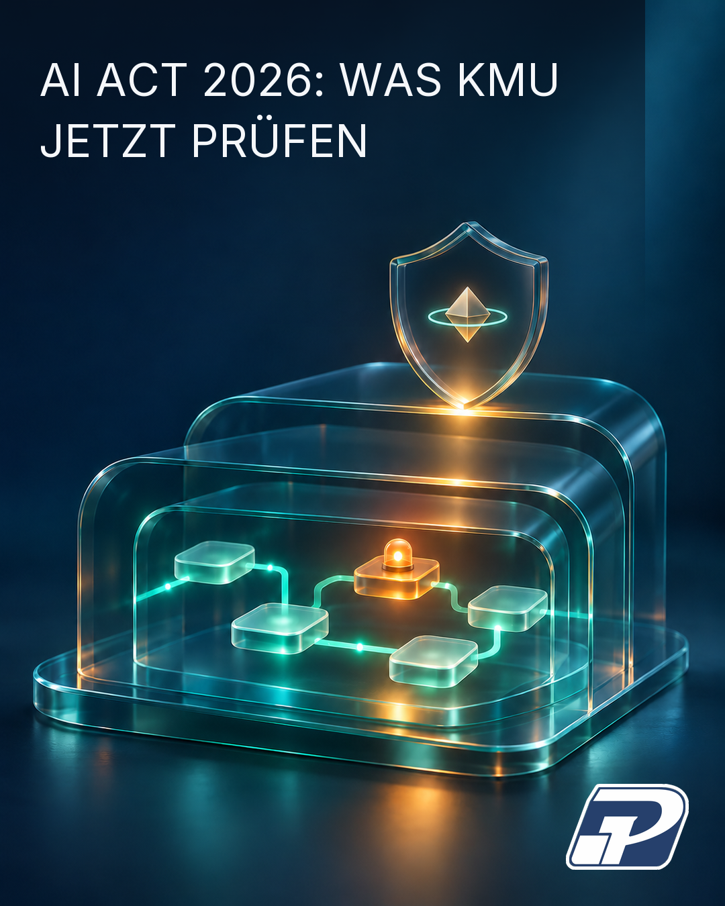

# AI Agent Builder – Wochenkampagne 2026-11-20-eu-ai-act-kmu-2026

**Status: drei geprüfte, vordatierte Buffer-Drafts. Keine Veröffentlichung.**

Unabhängiger Buffer-Rücklesezeitpunkt (UTC): 2026-11-20T11:15:59.492216+00:00

Dies ist ein **Snapshot**. Spätere Bearbeitungen direkt in Buffer sind maßgeblich und dürfen bei Freigabe nicht durch diese Fassung überschrieben werden.

Der Buffer-Link führt zum offiziellen Dashboard, **nicht** direkt in den einzelnen Post. Buffer dokumentiert derzeit keinen verlässlichen API-Deep-Link zu unveröffentlichten Entwürfen.

## LinkedIn

**Vorgesehener Zeitpunkt:** 2026-12-16T16:00:00+01:00 (Europe/Berlin) / 2026-12-16T15:00:00Z (UTC)  
**Status:** draft, nicht in der Veröffentlichungswarteschlange  
**Buffer-Post-ID:** 6b002be239116a845dd02cca  
**Kanal-ID:** 6aac167eea19ca0bde6ada5b

[Buffer öffnen – Kanal LinkedIn → Drafts](https://publish.buffer.com) (Dashboard-Einstieg, kein individueller Post-Link)

**Tatsächlich von Buffer zurückgelesener Beitragstext:**

~~~~text
AI Act 2026: Mehr Zeit für bestimmte Regeln heißt nicht weniger Verantwortung für KI-Agenten.

Seit dem 27. Juli 2026 gilt der sogenannte AI Omnibus (Verordnung EU 2026/1744). Er vereinfacht Teile der europäischen KI-Regeln. Für bestimmte Hochrisiko-Anwendungen wurden die Fristen angepasst: unter anderem auf den 2. Dezember 2027 für Fälle nach Anhang III und den 2. August 2028 für Hochrisiko-KI in bestimmten regulierten Produkten nach Anhang I. Das ist keine pauschale Verschiebung des gesamten AI Act.

Was bedeutet das für einen mittelständischen Betrieb, der heute einen KI-Agenten einführt?

Ich würde mit fünf Fragen anfangen:

1. INVENTAR: Welche KI-Systeme und Agenten setzen wir tatsächlich ein?
2. ROLLE: Sind wir Anbieter oder Betreiber – und wer ist verantwortlich?
3. RISIKO: Welche konkreten Aufgaben führt das System aus, und welche Regeln gelten dafür?
4. DATEN: Woher kommen Informationen, und wohin fließen sie?
5. FREIGABE: Welche Aktionen darf der Agent vorbereiten, welche muss ein Mensch bestätigen?

Beispiel: Ein Agent kann eingehende Kundenanfragen sortieren und eine Antwort vorschlagen. Ob er sie ohne Prüfung versenden darf, ist eine gesonderte Entscheidung über Prozess, Risiko und Rechte.

Mein Fazit: Die neue Rechtslage ist ein guter Anlass für eine saubere Bestandsaufnahme – kein Grund, die Kontrollen auszusetzen. Die rechtliche Einordnung hängt vom konkreten Anwendungsfall ab.

Welche dieser fünf Fragen ist bei euch heute am schwierigsten zu beantworten?

Quellen: Europäische Kommission, 27.07.2026; Verordnung (EU) 2026/1744.
https://digital-strategy.ec.europa.eu/en/news/ai-omnibus-enters-force

#AIAct #KIAgenten #Mittelstand #AIGovernance #AIagentBuilder
~~~~

## Facebook

**Vorgesehener Zeitpunkt:** 2026-12-17T09:00:00+01:00 (Europe/Berlin) / 2026-12-17T08:00:00Z (UTC)  
**Status:** draft, nicht in der Veröffentlichungswarteschlange  
**Buffer-Post-ID:** 6b002be79dd03fda0b064a26  
**Kanal-ID:** 6ac781e46a5c39ccb64fe01c

[Buffer öffnen – Kanal Facebook → Drafts](https://publish.buffer.com) (Dashboard-Einstieg, kein individueller Post-Link)

**Tatsächlich von Buffer zurückgelesener Beitragstext:**

~~~~text
🇪🇺 Der EU AI Act wurde 2026 angepasst. Was heißt das für Betriebe mit KI-Agenten?

Der AI Omnibus ist seit dem 27. Juli 2026 in Kraft. Für bestimmte Hochrisiko-KI gelten neue Fristen, und einzelne Vorgaben wurden vereinfacht. Aber: Nicht alle Pflichten sind auf später verschoben.

Für den Alltag im Mittelstand finde ich drei praktische Fragen wichtiger als Schlagzeilen über Termine:

🔹 WO? In welchen Prozessen arbeitet bei uns bereits KI – vielleicht auch unsichtbar in einer Software?
🔹 WAS? Welche Daten sieht der Agent, und was darf er selbstständig verändern oder versenden?
🔹 WER? Wer prüft Ergebnisse und übernimmt die Freigabe bei wichtigen Entscheidungen?

Stell dir einen KI-Agenten vor, der Rechnungsdaten ausliest und Buchungsvorschläge erstellt. Das kann Zeit sparen. Die endgültige Buchung sollte aber zu einem klar definierten Prüf- und Rechtekonzept passen.

Mein Tipp: Erst die eigenen Anwendungsfälle erfassen, dann die passenden Anforderungen prüfen. Eine allgemeine Fristenübersicht ersetzt diese Einordnung nicht.

Wie weit seid ihr mit einer Übersicht eurer KI-Anwendungen?

Quelle: Europäische Kommission, 27.07.2026, und EU-Verordnung 2026/1744.
https://digital-strategy.ec.europa.eu/en/news/ai-omnibus-enters-force

#AIAct #KünstlicheIntelligenz #Mittelstand #KIAgenten
~~~~

## Instagram

**Vorgesehener Zeitpunkt:** 2026-12-16T18:00:00+01:00 (Europe/Berlin) / 2026-12-16T17:00:00Z (UTC)  
**Status:** draft, nicht in der Veröffentlichungswarteschlange  
**Buffer-Post-ID:** 6b002bebc0a7142f84b4bff1  
**Kanal-ID:** 6ac79a686a5c39ccb650f94b

[Buffer öffnen – Kanal Instagram → Drafts](https://publish.buffer.com) (Dashboard-Einstieg, kein individueller Post-Link)

**Tatsächlich von Buffer zurückgelesener Beitragstext:**

~~~~text
🇪🇺 AI ACT 2026: ERST EINORDNEN, DANN AUTOMATISIEREN.

Der AI Omnibus ist seit 27. Juli 2026 in Kraft. Er vereinfacht Teile der Regeln und verschiebt bestimmte Hochrisiko-Fristen. ⏳

Wichtig: Das ist KEIN Freifahrtschein für jeden KI-Agenten.

Für deinen Betrieb zählen jetzt drei Checks:

1️⃣ EINSATZ: Wo arbeitet bereits KI mit?
2️⃣ KONTROLLE: Auf welche Daten und Aktionen darf ein Agent zugreifen?
3️⃣ FREIGABE: Wer bestätigt kritische Schritte?

💡 Praxisbeispiel: Der Agent liest eine Kundenanfrage, bereitet die Antwort vor – ein Mensch prüft sie vor dem Versand.

Neue Fristen sind hilfreich. Klare Verantwortlichkeiten bleiben unverzichtbar.

💬 Hast du schon eine Liste deiner KI-Anwendungen?

Quelle: EU-Kommission, 27.07.2026; Verordnung (EU) 2026/1744.

#AIAct #KIAgentBuilder #KIAgenten #AIGovernance #Mittelstand #Digitalisierung
~~~~

**Deine Entscheidung:** „freigegeben“, direkt in Buffer ändern, oder hier Änderungen beauftragen. „Freigegeben“ allein ist **noch keine** technische Live-Queue-Aktion: Vor einem späteren Scheduling müssen die drei bestehenden Post-IDs und die dann aktuellen Texte/Bilder/Termine erneut direkt in Buffer geprüft werden. Keine Duplikate.
